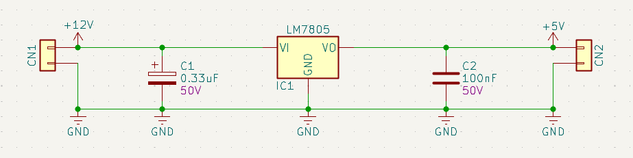

# PCB Thermal Simulation
PCB layout thermal simulation using [ElmerFEM](https://github.com/elmercsc/elmerfem), [PoeAlex KiCAD-Thermal-Sim](https://github.com/PoeAlex/KiCad_Thermal_Sim) repository and [KiPIDA](https://github.com/kbralten/KiPIDA/tree/main) KiCAD plugin. 

## Used Tools
* [KiCAD](https://www.kicad.org/) v10.0.7
* [FreeCAD](https://www.freecad.org/) v1.1.4
* [Paraview](https://www.paraview.org/) 6.2.0

# Main Goal
Simulate and analyze the thermal characteristics of a simple LM7805 circuit, with a 12 V input, 5 V output, and load currents of 0.5 A and 1 A, using different configurations of the TO-220 package. After the simulation, validate using practical examples.

# Circuit
Circuit characteristics and thermal assumptions are presented below.

## Schematic

## PCB Layout

## Thermal Characteristics